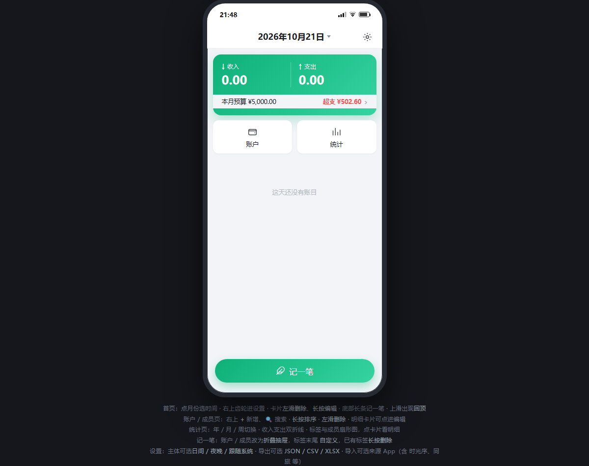

# 一笔 · OneEntry

一笔是一款本地优先、支持多成员记录的 Android 记账应用，使用 Flutter 开发。它适合个人、家庭、情侣或旅行同行者在同一本账中管理收支、账户、成员与预算。

<p align="center">
  
</p>

> 预览图来自项目早期交互原型。可下载 [HTML 交互原型](docs/oneentry-prototype.html) 后在浏览器中完整体验。实际应用已根据真机使用反馈继续优化，细节可能与原型略有不同。

## 主要功能

- **收支与转账**：记录支出、收入、账户间转账和余额调整。
- **金额算式**：金额框可直接输入 `+ - × ÷` 或 `* /` 四则运算，支持括号，保存时自动计算结果。
- **多成员记账**：每笔账可选择一个或多个成员，并支持 AA 均摊或整笔计入。
- **账户管理**：管理现金、银行卡、支付工具等账户，支持排序、归档和余额明细。
- **自定义标签**：支持支出、收入标签和 200 余个图标，可排序、编辑、合并与移除。
- **预算与统计**：提供月度预算、分类预算、收支构成、成员构成和明细下钻。
- **搜索与批量操作**：按时间、标签、成员、备注搜索，并可批量编辑或删除账目。
- **周期账目**：管理按天、周、月或年重复的账目规则。
- **数据导入导出**：支持 JSON、ZIP、XLSX，以及同旅、时光序和通用表格数据。
- **显示与无障碍**：支持日间/夜间主题、系统跟随、文字缩放和增强颜色对比。

## 数据与隐私

账本使用 SQLite 保存在应用内部，无需登录或云端服务。金额以整数分存储，转账、余额变更和多人分摊在数据库事务中完成。

建议定期从设置页导出 ZIP 或 JSON 完整备份，特别是在卸载应用或更换设备之前。

## 安装 APK

GitHub Actions 会按 CPU 架构生成独立 APK，避免通用安装包同时携带多套原生库。

- `app-arm64-v8a-release.apk`：大多数现代 Android 手机和平板。
- `app-armeabi-v7a-release.apk`：较旧的 32 位 ARM 设备。
- `app-x86_64-release.apk`：Android 模拟器或 x86 设备。

在 GitHub 仓库的 **Actions** 或 **Releases** 中下载对应文件。绝大多数真机应选择 `arm64-v8a`。

## 本地开发

需要 Flutter `3.41.4` 或与项目兼容的更高版本，以及 Android SDK/JDK 17。

```text
flutter pub get
flutter run
```

使用 Android Studio 时，请打开项目根目录，安装 Flutter 和 Dart 插件，然后在已连接真机或模拟器上运行 `lib/main.dart`。

## GitHub Actions 构建

推送到 `main` 后，`.github/workflows/android-debug.yml` 会自动执行格式检查、静态分析和 APK 构建。也可在 **Actions → Build Android APK → Run workflow** 手动触发。

如果仓库配置了签名 Secrets，工作流会生成 release APK；否则生成 debug APK。

## 项目信息

- Android 应用 ID：`com.junxu.yibi`
- 数据库：SQLite / `oneentry.db`
- 主要框架：Flutter + Android Kotlin
- 项目状态：主要功能已完成，可日常使用
